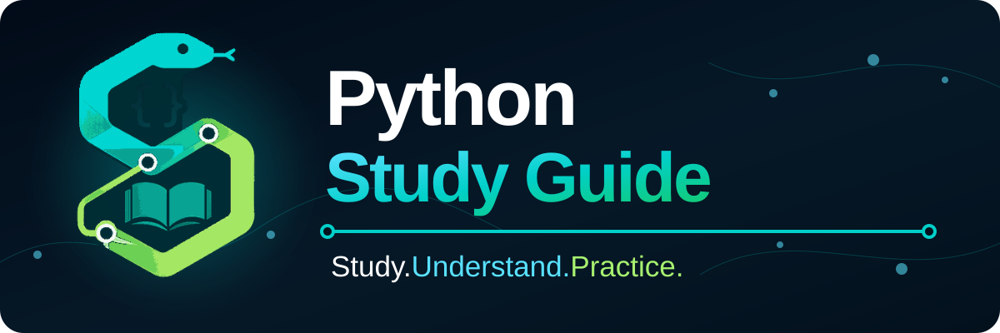

<div align="center">

# Python Study Guide 🐍

### Study. Understand. Practice.



[🇺🇸 English](README.md) · [🇧🇷 Português](docs/localized/README.pt-BR.md) · [🇪🇸 Español](docs/localized/README.es.md)

<p>
  
  <a href="LICENSE"></a>
  
  <a href="https://github.com/RamonRDR/python-study-guide/actions/workflows/quality-checks.yml"></a>
</p>

<p>
  
  
  
  
  
</p>

<p>
  <a href="https://github.com/RamonRDR/python-study-guide/actions/runs/34731456104"></a>
  <a href="https://github.com/RamonRDR/python-study-guide/actions/runs/34731456104"></a>
  <a href="https://github.com/RamonRDR/python-study-guide/actions/runs/34731456104"></a>
  <a href="https://github.com/RamonRDR/python-study-guide/actions/runs/34731456104"></a>
  <a href="https://github.com/RamonRDR/python-study-guide/actions/runs/34731456104"></a>
</p>

<p>
  <a href="https://github.com/RamonRDR/python-study-guide/actions/runs/34731456104"></a>
  <a href="https://github.com/RamonRDR/python-study-guide/actions/runs/34731456104"></a>
  <a href="https://github.com/RamonRDR/python-study-guide/actions/runs/34731456104"></a>
  <a href="https://github.com/RamonRDR/python-study-guide/actions/runs/34731456104"></a>
  <a href="https://github.com/RamonRDR/python-study-guide/tree/main/practical-projects"></a>
</p>

<p>
  <a href="https://github.com/RamonRDR/python-study-guide/tree/main/docs/ai-assisted-development"></a>
</p>

<sub>Test and quality numbers are verified snapshots from <a href="https://github.com/RamonRDR/python-study-guide/actions/runs/34731456104">GitHub Actions (2026-09-13 UTC)</a>, not a live test count. Linux and Windows pytest suites overlap and should not be added together. Dependency badges show compatible version ranges, not pinned installations.</sub>

</div>

A multilingual, practical guide for studying Python, understanding how its parts connect, and applying them through clear examples.

This project is designed both as a learning path and as a quick-reference library. Instead of presenting isolated commands, each topic explains what a resource does, why it exists, when to use it, when to avoid it, and how it works with other parts of Python.

## Why is the code written in English?

Folder names, file names, variables, functions, classes, and other identifiers are written in English. This helps learners become familiar with conventions commonly found in libraries, technical documentation, and international software projects.

The explanations are available in English, Brazilian Portuguese, and Spanish.

## How to study

Each chapter follows a consistent structure:

1. What it is
2. Why it exists
3. Syntax and conventions
4. When to use it
5. When to avoid it
6. How it connects to other resources
7. Basic and practical examples
8. Common mistakes
9. Exercise
10. Review checklist
11. Quick-reference summary

## Learning roadmap

The guide grows from Python fundamentals to functions, documentation, error handling, files, the standard library, external libraries, testing, and practical projects.

- [Full learning path: direct links to every published chapter](docs/learning-path.en.md)
- [Roadmap in English](docs/roadmap.en.md)
- [Roadmap em Português](docs/roadmap.pt-BR.md)
- [Roadmap en Español](docs/roadmap.es.md)

## Project structure

```text
python-study-guide/
├── assets/
├── comments-and-documentation/
├── collections/
├── docs/
├── errors-files-and-modules/
├── exercises/
├── external-libraries/
├── functions/
├── fundamentals/
├── practical-projects/
├── program-flow/
├── scripts/
├── standard-library/
├── strings-and-numbers/
└── tests/
```

Detailed explanations:

- [Project structure in English](docs/project-structure.en.md)
- [Estrutura do projeto em Português](docs/project-structure.pt-BR.md)
- [Estructura del proyecto en Español](docs/project-structure.es.md)

## Current status

The project foundation and **Phases 1–10 are complete**. **Phase 10: Practical Projects is complete** with all eight planned projects implemented, documented, tested, reviewed, and integrated.

The practical-project phase closes by combining validated data models, deterministic workflows, exact arithmetic, persistence and reporting, filesystem automation, reconciliation, orchestration, structured evidence, and automated regression coverage across the eight projects.

See the [Practical Projects index](practical-projects/README.md), [roadmap](docs/roadmap.en.md), or [full learning path](docs/learning-path.en.md) for the current curriculum status.

## Visual identity

The project emblem connects Python, code, learning, and relationships between concepts through a geometric serpent, braces, an open book, and connected nodes.

See the [visual identity guide](assets/README.md) for available assets, palette, meaning, accessibility guidance, and usage rules.

## AI-assisted development

This project uses AI tools, including ChatGPT and Codex, to support planning, research, drafting, translation, review, and repository maintenance.

AI output is not accepted automatically. Every change must be understood, verified, and reviewed by the maintainer before it is incorporated into the `main` branch.

Repository-wide working instructions for AI agents and contributors are recorded in [AGENTS.md](AGENTS.md). Read the [AI-assisted development guide](docs/ai-assisted-development/README.en.md) for the responsible workflow.

## Authorship and maintenance

Python Study Guide was created and is maintained by [Ramon Estevez Rodriguez](https://github.com/RamonRDR).

Community contributions remain credited through commit metadata, Git history, and pull requests. Read the [project authorship record](AUTHORS.md) for the complete attribution policy.

## Community and support

Participation is governed by the [Code of Conduct](CODE_OF_CONDUCT.md). The [Support Guide](SUPPORT.md) explains where different questions and requests belong. Potential vulnerabilities must follow the private process in the [Security Policy](SECURITY.md).

## Contributing

Contributions, corrections, examples, and translation improvements are welcome. Read the contribution guide in [English](CONTRIBUTING.md), [Portuguese](docs/localized/CONTRIBUTING.pt-BR.md), or [Spanish](docs/localized/CONTRIBUTING.es.md) before opening a pull request.

## License

This project is available under the [MIT License](LICENSE).