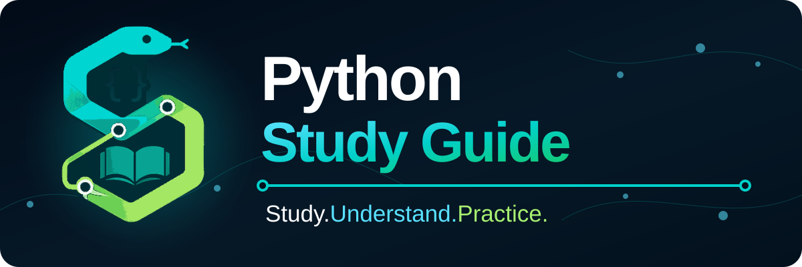

<div align="center">

# Guía de Estudio de Python 🐍

### Estudia. Comprende. Practica.



[🇺🇸 English](../../README.md) · [🇧🇷 Português](README.pt-BR.md) · [🇪🇸 Español](README.es.md)

<p>
  
  <a href="../../LICENSE"></a>
  
  <a href="https://github.com/RamonRDR/python-study-guide/actions/workflows/quality-checks.yml"></a>
</p>

<p>
  
  
  
  
  
</p>

<p>
  <a href="https://github.com/RamonRDR/python-study-guide/actions/runs/34731456104"></a>
  <a href="https://github.com/RamonRDR/python-study-guide/actions/runs/34731456104"></a>
  <a href="https://github.com/RamonRDR/python-study-guide/actions/runs/34731456104"></a>
  <a href="https://github.com/RamonRDR/python-study-guide/actions/runs/34731456104"></a>
  <a href="https://github.com/RamonRDR/python-study-guide/actions/runs/34731456104"></a>
</p>

<p>
  <a href="https://github.com/RamonRDR/python-study-guide/actions/runs/34731456104"></a>
  <a href="https://github.com/RamonRDR/python-study-guide/actions/runs/34731456104"></a>
  <a href="https://github.com/RamonRDR/python-study-guide/actions/runs/34731456104"></a>
  <a href="https://github.com/RamonRDR/python-study-guide/actions/runs/34731456104"></a>
  <a href="https://github.com/RamonRDR/python-study-guide/tree/main/practical-projects"></a>
</p>

<p>
  <a href="https://github.com/RamonRDR/python-study-guide/tree/main/docs/ai-assisted-development"></a>
</p>

<sub>Los números de pruebas y calidad son resultados verificados en <a href="https://github.com/RamonRDR/python-study-guide/actions/runs/34731456104">GitHub Actions (13/09/2026 UTC)</a>, no recuentos en tiempo real. Las suites pytest de Linux y Windows se solapan y no deben sumarse. Las versiones de dependencias representan rangos compatibles, no instalaciones fijadas.</sub>

</div>

Una guía práctica y multilingüe para estudiar Python, comprender cómo se conectan sus partes y aplicar los conceptos mediante ejemplos claros.

Este proyecto funciona como ruta de aprendizaje y también como biblioteca de consulta rápida. En lugar de presentar comandos aislados, cada tema explica qué hace un recurso, por qué existe, cuándo utilizarlo, cuándo evitarlo y cómo funciona junto con otras partes de Python.

## ¿Por qué el código está escrito en inglés?

Los nombres de carpetas, archivos, variables, funciones, clases y otros identificadores están escritos en inglés. Esto ayuda a quienes están aprendiendo a familiarizarse con convenciones comunes en bibliotecas, documentación técnica y proyectos internacionales.

Las explicaciones están disponibles en inglés, portugués de Brasil y español.

## Cómo estudiar

Cada capítulo sigue una estructura consistente:

1. Qué es
2. Por qué existe
3. Sintaxis y convenciones
4. Cuándo utilizarlo
5. Cuándo evitarlo
6. Cómo se conecta con otros recursos
7. Ejemplos básicos y prácticos
8. Errores comunes
9. Ejercicio
10. Lista de revisión
11. Resumen de consulta rápida

## Ruta de aprendizaje

La guía crece desde los fundamentos de Python hasta funciones, documentación, manejo de errores, archivos, biblioteca estándar, bibliotecas externas, pruebas y proyectos prácticos.

- [Ruta completa de aprendizaje: enlaces directos a todos los capítulos publicados](../learning-path.es.md)
- [Roadmap en Español](../roadmap.es.md)
- [Roadmap in English](../roadmap.en.md)
- [Roadmap em Português](../roadmap.pt-BR.md)

## Estructura del proyecto

```text
python-study-guide/
├── assets/
├── comments-and-documentation/
├── collections/
├── docs/
├── errors-files-and-modules/
├── exercises/
├── external-libraries/
├── functions/
├── fundamentals/
├── practical-projects/
├── program-flow/
├── scripts/
├── standard-library/
├── strings-and-numbers/
└── tests/
```

Explicaciones detalladas:

- [Estructura del proyecto en Español](../project-structure.es.md)
- [Project structure in English](../project-structure.en.md)
- [Estrutura do projeto em Português](../project-structure.pt-BR.md)

## Estado actual

La base del proyecto y las **Fases 1–10 están completadas**. La **Fase 10: Proyectos Prácticos está completada**, con los ocho proyectos planificados implementados, documentados, probados, revisados e integrados.

La fase de proyectos prácticos cierra la ruta combinando modelos de datos validados, flujos deterministas, aritmética exacta, persistencia e informes, automatización del filesystem, conciliación, orquestación, evidencia estructurada y cobertura automatizada de regresión a lo largo de los ocho proyectos.

Consulta el [índice de Proyectos Prácticos](../../practical-projects/README.es.md), el [roadmap](../roadmap.es.md) o la [ruta completa de aprendizaje](../learning-path.es.md) para el estado actual del currículo.

## Identidad visual

El símbolo del proyecto conecta Python, código, aprendizaje y relaciones entre conceptos mediante una serpiente geométrica, llaves, un libro abierto y nodos conectados.

Consulta la [guía de identidad visual](../../assets/README.md) para conocer los archivos, la paleta, los significados, las orientaciones de accesibilidad y las reglas de uso.

## Desarrollo asistido por IA

Este proyecto utiliza herramientas de inteligencia artificial, incluidas ChatGPT y Codex, para apoyar la planificación, la investigación, la redacción, la traducción, la revisión y el mantenimiento del repositorio.

El contenido producido por IA no se acepta automáticamente. Cada cambio debe comprenderse, verificarse y revisarse antes de incorporarse a la rama `main`.

Las instrucciones generales están registradas en [AGENTS.md](../../AGENTS.md). Lee la [guía de desarrollo asistido por IA](../ai-assisted-development/README.es.md) para conocer el flujo responsable.

## Autoría y mantenimiento

Python Study Guide fue creado y es mantenido por [Ramon Estevez Rodriguez](https://github.com/RamonRDR).

Las contribuciones permanecen reconocidas en los metadatos de los commits, el historial de Git y los pull requests. Consulta el [registro de autoría del proyecto](AUTHORS.es.md).

## Comunidad y soporte

La participación se rige por el [Código de Conducta](CODE_OF_CONDUCT.es.md). La [Guía de Soporte](SUPPORT.es.md) explica qué canal corresponde a cada solicitud. Las posibles vulnerabilidades deben seguir el proceso privado de la [Política de Seguridad](SECURITY.es.md).

## Cómo contribuir

Las contribuciones, correcciones, ejemplos y mejoras de traducción son bienvenidas. Lee la [guía de contribución en español](CONTRIBUTING.es.md) antes de abrir un pull request. También están disponibles las versiones en [inglés](../../CONTRIBUTING.md) y [portugués](CONTRIBUTING.pt-BR.md).

## Licencia

Este proyecto está disponible bajo la [Licencia MIT](../../LICENSE).
