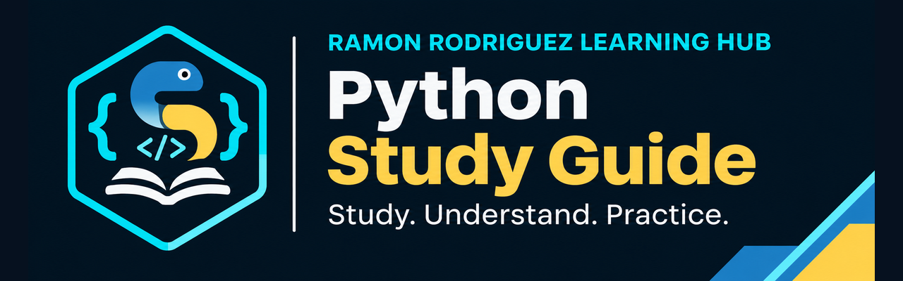

<div align="center">

# Guía de Estudio de Python 🐍

### Estudia. Comprende. Practica.



<p align="center"><strong>🌐 Elige tu idioma</strong><br/><sub>Disponible en 3 idiomas</sub></p>
<p align="center">
  <a href="../../README.md" title="English (default)"></a>
  <a href="README.pt-BR.md" title="Português (Brasil)"></a>
  <a href="README.es.md" title="Español"></a>
</p>

<!-- learning-hub:start -->
<p align="center"><strong>Ramon Rodriguez Learning Hub</strong><br/><sub>Explora. Aprende. Construye.</sub></p>
<p align="center">
  <a href="README.es.md" title="Guía actual"></a>
  <br/><sub>Guía actual: Python</sub>
</p>
<!-- learning-hub:end -->

<p align="center"><sub>Creado y mantenido por Ramon Rodriguez</sub></p>
<p align="center">
  <a href="https://www.linkedin.com/in/ramon-e-rodriguez/"></a>
  <a href="https://ramonrodriguez.com.br/"></a>
  <a href="https://rdrlabs.com.br/"></a>
  <a href="https://github.com/RamonRDR"></a>
</p>

<hr />

<!-- technical-badges:start -->
<p align="center"><strong>Tecnología e integración continua</strong></p>

<p align="center">
  
  <a href="../../LICENSE"></a>
  
  <a href="https://github.com/RamonRDR/python-study-guide/actions/workflows/quality-checks.yml"></a>
</p>

<hr />

<p align="center"><strong>Bibliotecas y dependencias</strong></p>

<p align="center">
  
  
  
  
  
</p>

<hr />

<p align="center"><strong>Pruebas y ejecución</strong></p>

<p align="center">
  <a href="https://github.com/RamonRDR/python-study-guide/actions/runs/46093278698"></a>
  <a href="https://github.com/RamonRDR/python-study-guide/actions/runs/46093278698"></a>
  <a href="https://github.com/RamonRDR/python-study-guide/actions/runs/46093278698"></a>
  <a href="https://github.com/RamonRDR/python-study-guide/actions/runs/46093278698"></a>
</p>

<p align="center">
  <a href="https://github.com/RamonRDR/python-study-guide/actions/runs/46093278698"></a>
  <a href="https://github.com/RamonRDR/python-study-guide/actions/runs/46093278698"></a>
  <a href="https://github.com/RamonRDR/python-study-guide/actions/runs/46093278698"></a>
  <a href="https://github.com/RamonRDR/python-study-guide/actions/runs/46093278698"></a>
</p>

<hr />

<p align="center"><strong>Documentación e integridad del repositorio</strong></p>

<p align="center">
  <a href="https://github.com/RamonRDR/python-study-guide/actions/runs/46093278698"></a>
  <a href="https://github.com/RamonRDR/python-study-guide/actions/runs/46093278698"></a>
  <a href="https://github.com/RamonRDR/python-study-guide/actions/runs/46093278698"></a>
  <a href="https://github.com/RamonRDR/python-study-guide/actions/runs/46093278698"></a>
</p>

<p align="center">
  <a href="https://github.com/RamonRDR/python-study-guide/actions/runs/46093278698"></a>
  <a href="https://github.com/RamonRDR/python-study-guide/actions/runs/46093278698"></a>
  <a href="https://github.com/RamonRDR/python-study-guide/actions/runs/46093278698"></a>
  <a href="https://github.com/RamonRDR/python-study-guide/actions/runs/46093278698"></a>
</p>

<hr />

<p align="center"><strong>Ingeniería y desarrollo</strong></p>

<p align="center">
  <a href="https://github.com/RamonRDR/python-study-guide/tree/main/practical-projects"></a>
  <a href="https://github.com/RamonRDR/python-study-guide/tree/main/docs/ai-assisted-development"></a>
</p>

<sub>Resultados verificados: <a href="https://github.com/RamonRDR/python-study-guide/actions/runs/46093278698">GitHub Actions ejecución 46093278698 (28/11/2026 UTC)</a>, main posterior al merge <code>55e9ea1</code>. Los recuentos no son en tiempo real. Windows corresponde al subconjunto File Organizer de la suite Linux de proyectos; no sumes los resultados. Las cifras de enlaces internos y documentos Markdown corresponden al verificador de enlaces, no a la disponibilidad de URLs externas. Las insignias de dependencias representan rangos compatibles, no un lockfile. La insignia de contenido inmutable se refiere a 959 rutas canónicas comparadas con el contenido histórico.</sub>
<!-- technical-badges:end -->

</div>

Una guía práctica y multilingüe para estudiar Python, comprender cómo se conectan sus partes y aplicar los conceptos mediante ejemplos claros.

Este proyecto funciona como ruta de aprendizaje y también como biblioteca de consulta rápida. En lugar de presentar comandos aislados, cada tema explica qué hace un recurso, por qué existe, cuándo utilizarlo, cuándo evitarlo y cómo funciona junto con otras partes de Python.

## ¿Por qué el código está escrito en inglés?

Los nombres de carpetas, archivos, variables, funciones, clases y otros identificadores están escritos en inglés. Esto ayuda a quienes están aprendiendo a familiarizarse con convenciones comunes en bibliotecas, documentación técnica y proyectos internacionales.

Las explicaciones están disponibles en inglés, portugués de Brasil y español.

## Cómo estudiar

¿Nunca has programado? Empieza con [Primeros pasos](../../getting-started/README.es.md) para instalar Python, preparar tu editor, ejecutar tu primer archivo, crear un entorno aislado por proyecto, gestionar dependencias y registrar cambios con Git. Después sigue la ruta completa.

Los capítulos centrales del lenguaje siguen una estructura consistente (la introducción y los proyectos prácticos la adaptan a su finalidad):

1. Qué es
2. Por qué existe
3. Sintaxis y convenciones
4. Cuándo utilizarlo
5. Cuándo evitarlo
6. Cómo se conecta con otros recursos
7. Ejemplos básicos y prácticos
8. Errores comunes
9. Ejercicio
10. Lista de revisión
11. Resumen de consulta rápida

## Requisitos previos

Una computadora con una instalación Python compatible y un editor de texto basta para estudiar localmente. Empieza por Primeros pasos; usa el intérprete comprobado del proyecto en los comandos. Instala paquetes externos solo cuando la lección los necesite. Las bibliotecas posteriores usan el [contrato de dependencias](../../requirements-external.txt) del repositorio. No se requiere servicio de pago ni asistente de IA.

## Ruta de aprendizaje

<table align="center">
  <thead>
    <tr>
      <th scope="col">Orden</th>
      <th scope="col">Módulo</th>
      <th scope="col">Lecciones/proyectos</th>
    </tr>
  </thead>
  <tbody>
    <tr>
      <td>00</td>
      <td><a href="../../getting-started/README.es.md">Primeros pasos</a></td>
      <td align="right">6</td>
    </tr>
    <tr>
      <td>01</td>
      <td><a href="../../fundamentals/README.es.md">Fundamentos</a></td>
      <td align="right">6</td>
    </tr>
    <tr>
      <td>02</td>
      <td><a href="../../strings-and-numbers/README.es.md">Textos y números</a></td>
      <td align="right">4</td>
    </tr>
    <tr>
      <td>03</td>
      <td><a href="../../collections/README.es.md">Colecciones</a></td>
      <td align="right">6</td>
    </tr>
    <tr>
      <td>04</td>
      <td><a href="../../program-flow/README.es.md">Flujo del programa</a></td>
      <td align="right">8</td>
    </tr>
    <tr>
      <td>05</td>
      <td><a href="../../functions/README.es.md">Funciones</a></td>
      <td align="right">9</td>
    </tr>
    <tr>
      <td>06</td>
      <td><a href="../../comments-and-documentation/README.es.md">Comentarios y documentación</a></td>
      <td align="right">6</td>
    </tr>
    <tr>
      <td>07</td>
      <td><a href="../../errors-files-and-modules/README.es.md">Errores, archivos y módulos</a></td>
      <td align="right">5</td>
    </tr>
    <tr>
      <td>08</td>
      <td><a href="../../standard-library/README.es.md">Biblioteca estándar</a></td>
      <td align="right">9</td>
    </tr>
    <tr>
      <td>09</td>
      <td><a href="../../external-libraries/README.es.md">Bibliotecas externas</a></td>
      <td align="right">4</td>
    </tr>
    <tr>
      <td>10</td>
      <td><a href="../../practical-projects/README.es.md">Proyectos prácticos</a></td>
      <td align="right">8</td>
    </tr>
    <tr>
      <td>Complemento</td>
      <td><a href="../../manual-programming-practices/README.es.md">Práctica manual e ingeniería de software</a></td>
      <td align="right">4</td>
    </tr>
    <tr>
      <td>11</td>
      <td><a href="../../problem-solving-and-live-coding/README.es.md">Resolución de problemas y live coding</a></td>
      <td align="right">16</td>
    </tr>
    <tr>
      <td>12</td>
      <td><a href="../../technical-interview-preparation/README.es.md">Preparación para entrevistas técnicas</a></td>
      <td align="right">24</td>
    </tr>
  </tbody>
</table>

- [Ruta completa de aprendizaje: enlaces directos a todos los capítulos publicados](../learning-path.es.md)
- [Roadmap en Español](../roadmap.es.md)
- [Roadmap in English](../roadmap.en.md)
- [Roadmap em Português](../roadmap.pt-BR.md)

## Estructura del proyecto

```text
python-study-guide/
├── assets/
├── comments-and-documentation/
├── collections/
├── docs/
├── errors-files-and-modules/
├── exercises/
├── quizzes/
├── schemas/
├── external-libraries/
├── functions/
├── getting-started/
├── fundamentals/
├── manual-programming-practices/
├── practical-projects/
├── problem-solving-and-live-coding/
├── program-flow/
├── scripts/
├── standard-library/
├── strings-and-numbers/
├── technical-interview-preparation/
└── tests/
```

Explicaciones detalladas:

- [Estructura del proyecto en Español](../project-structure.es.md)
- [Project structure in English](../project-structure.en.md)
- [Estrutura do projeto em Português](../project-structure.pt-BR.md)

## Estado actual

**Python Study Guide 2.0 · Phase II: Learning Hub Foundation completada.** Sprints 00–09 (incluidos 09A y 09B) y AC-00–09 cerrados ([cierre oficial](https://github.com/RamonRDR/python-study-guide/pull/114#issuecomment-7227229546), [CI final](https://github.com/RamonRDR/python-study-guide/actions/runs/46060408182)). El currículo contiene 14 módulos, 115 entradas, 160 cuestionarios, 30 ejercicios, 60 preguntas de entrevista y tres simulacros. El [handoff para Learning Hub](../specs/learning-hub-foundation/handoff.es.md) y la revisión inmutable de contenido están aprobados dentro del alcance del repositorio; ejecución en navegador y sitio externo siguen siendo trabajos separados. La guía permanece independiente del futuro Learning Hub y Git Study Guide.

[Plan de implementación de Phase II](../specs/learning-hub-foundation/implementation-plan.es.md)

La base original del proyecto, **Primeros pasos (seis lecciones)** y las **Fases 1–10 están completadas**. El currículo actual contiene 107 lecciones y ocho proyectos prácticos, en 14 módulos y tres idiomas. La **Fase 10: Proyectos Prácticos está completada**, con los ocho proyectos planificados implementados, documentados, probados, revisados e integrados.

La fase de proyectos prácticos cierra la ruta combinando modelos de datos validados, flujos deterministas, aritmética exacta, persistencia e informes, automatización del filesystem, conciliación, orquestación, evidencia estructurada y cobertura automatizada de regresión a lo largo de los ocho proyectos.

Consulta el [índice de Proyectos Prácticos](../../practical-projects/README.es.md), el [roadmap](../roadmap.es.md) o la [ruta completa de aprendizaje](../learning-path.es.md) para el estado actual del currículo.

Siete lecciones de fundamentos y nueve de retos ofrecen 30 ejercicios (12 fáciles, 12 medios, seis difíciles), incluidas dos prácticas cronometradas. Sprint 05 completado ([PR #95](https://github.com/RamonRDR/python-study-guide/pull/95)).

[Banco de retos](../../exercises/README.es.md)

## Identidad visual

El banner de presentación actual combina serpiente azul y amarilla, llaves, libro abierto e identidad del Learning Hub. Se conservan el emblema original y los recursos canónicos.

Consulta la [guía de identidad visual](../../assets/README.es.md) para conocer los archivos, la paleta, los significados, las orientaciones de accesibilidad y las reglas de uso.

## Desarrollo asistido por IA

Este proyecto utiliza herramientas de inteligencia artificial, incluidas ChatGPT y Codex, para apoyar la planificación, la investigación, la redacción, la traducción, la revisión y el mantenimiento del repositorio.

El contenido producido por IA no se acepta automáticamente. Cada cambio debe comprenderse, verificarse y revisarse antes de incorporarse a la rama `main`.

Las instrucciones generales están registradas en [AGENTS.md](../../AGENTS.md). Lee la [guía de desarrollo asistido por IA](../ai-assisted-development/README.es.md) para conocer el flujo responsable.

## Autoría y mantenimiento

Python Study Guide fue creado y es mantenido por [Ramon Estevez Rodriguez](https://github.com/RamonRDR).

Las contribuciones permanecen reconocidas en los metadatos de los commits, el historial de Git y los pull requests. Consulta el [registro de autoría del proyecto](AUTHORS.es.md).

## Comunidad y soporte

La participación se rige por el [Código de Conducta](CODE_OF_CONDUCT.es.md). La [Guía de Soporte](SUPPORT.es.md) explica qué canal corresponde a cada solicitud. Las posibles vulnerabilidades deben seguir el proceso privado de la [Política de Seguridad](SECURITY.es.md).

## Cómo contribuir

Las contribuciones, correcciones, ejemplos y mejoras de traducción son bienvenidas. Lee la [guía de contribución en español](CONTRIBUTING.es.md) antes de abrir un pull request. También están disponibles las versiones en [inglés](../../CONTRIBUTING.md) y [portugués](CONTRIBUTING.pt-BR.md).

## Licencia

Este proyecto está disponible bajo la [Licencia MIT](../../LICENSE).
