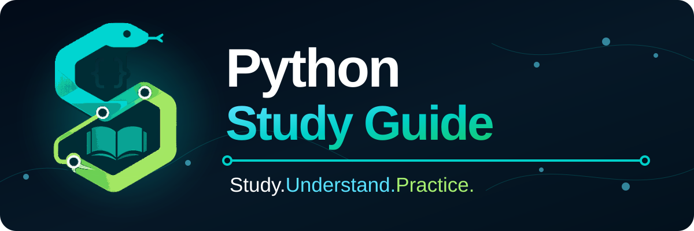

<div align="center">

# Guia de Estudos de Python 🐍

### Estude. Entenda. Pratique.



[🇺🇸 English](../../README.md) · [🇧🇷 Português](README.pt-BR.md) · [🇪🇸 Español](README.es.md)

<p>
  
  <a href="../../LICENSE"></a>
  
  <a href="https://github.com/RamonRDR/python-study-guide/actions/workflows/quality-checks.yml"></a>
</p>

<p>
  
  
  
  
  
</p>

<p>
  <a href="https://github.com/RamonRDR/python-study-guide/actions/runs/34731456104"></a>
  <a href="https://github.com/RamonRDR/python-study-guide/actions/runs/34731456104"></a>
  <a href="https://github.com/RamonRDR/python-study-guide/actions/runs/34731456104"></a>
  <a href="https://github.com/RamonRDR/python-study-guide/actions/runs/34731456104"></a>
  <a href="https://github.com/RamonRDR/python-study-guide/actions/runs/34731456104"></a>
</p>

<p>
  <a href="https://github.com/RamonRDR/python-study-guide/actions/runs/34731456104"></a>
  <a href="https://github.com/RamonRDR/python-study-guide/actions/runs/34731456104"></a>
  <a href="https://github.com/RamonRDR/python-study-guide/actions/runs/34731456104"></a>
  <a href="https://github.com/RamonRDR/python-study-guide/actions/runs/34731456104"></a>
  <a href="https://github.com/RamonRDR/python-study-guide/tree/main/practical-projects"></a>
</p>

<p>
  <a href="https://github.com/RamonRDR/python-study-guide/tree/main/docs/ai-assisted-development"></a>
</p>

<sub>Os números de testes e qualidade são resultados verificados no <a href="https://github.com/RamonRDR/python-study-guide/actions/runs/34731456104">GitHub Actions (13/09/2026 UTC)</a>, não contagens em tempo real. As suítes pytest de Linux e Windows se sobrepõem e não devem ser somadas. As versões das dependências representam faixas compatíveis, não instalações fixadas.</sub>

</div>

Um guia prático e multilíngue para estudar Python, entender como suas partes se conectam e aplicar os conceitos por meio de exemplos claros.

Este projeto funciona ao mesmo tempo como trilha de aprendizagem e biblioteca de consulta rápida. Em vez de apresentar comandos isolados, cada tema explica o que um recurso faz, por que existe, quando utilizá-lo, quando evitá-lo e como ele trabalha com outras partes do Python.

## Por que o código está em inglês?

Os nomes de pastas, arquivos, variáveis, funções, classes e outros identificadores são escritos em inglês. Isso ajuda quem está aprendendo a se familiarizar com convenções encontradas em bibliotecas, documentações técnicas e projetos internacionais.

As explicações estão disponíveis em inglês, português brasileiro e espanhol.

## Como estudar

Cada capítulo segue uma estrutura consistente:

1. O que é
2. Por que existe
3. Sintaxe e convenções
4. Quando utilizar
5. Quando evitar
6. Como se conecta a outros recursos
7. Exemplos básicos e práticos
8. Erros comuns
9. Exercício
10. Checklist de revisão
11. Resumo para consulta rápida

## Roadmap de aprendizagem

O guia cresce dos fundamentos do Python até funções, documentação, tratamento de erros, arquivos, biblioteca padrão, bibliotecas externas, testes e projetos práticos.

- [Trilha completa de estudos: links diretos para todos os capítulos publicados](../learning-path.pt-BR.md)
- [Roadmap em Português](../roadmap.pt-BR.md)
- [Roadmap in English](../roadmap.en.md)
- [Roadmap en Español](../roadmap.es.md)

## Estrutura do projeto

```text
python-study-guide/
├── assets/
├── comments-and-documentation/
├── collections/
├── docs/
├── errors-files-and-modules/
├── exercises/
├── external-libraries/
├── functions/
├── fundamentals/
├── practical-projects/
├── program-flow/
├── scripts/
├── standard-library/
├── strings-and-numbers/
└── tests/
```

Explicações detalhadas:

- [Estrutura do projeto em Português](../project-structure.pt-BR.md)
- [Project structure in English](../project-structure.en.md)
- [Estructura del proyecto en Español](../project-structure.es.md)

## Status atual

A fundação do projeto e as **Fases 1–10 estão concluídas**. A **Fase 10: Projetos Práticos está concluída**, com os oito projetos planejados implementados, documentados, testados, revisados e integrados.

A fase de projetos práticos encerra a trilha combinando modelos de dados validados, fluxos determinísticos, aritmética exata, persistência e relatórios, automação de filesystem, conciliação, orquestração, evidências estruturadas e cobertura automatizada de regressão ao longo dos oito projetos.

Consulte o [índice de Projetos Práticos](../../practical-projects/README.pt-BR.md), o [roadmap](../roadmap.pt-BR.md) ou a [trilha completa de estudos](../learning-path.pt-BR.md) para o status atual do currículo.

## Identidade visual

O símbolo do projeto conecta Python, código, aprendizagem e relações entre conceitos por meio de uma serpente geométrica, chaves, um livro aberto e nós conectados.

Consulte o [guia da identidade visual](../../assets/README.md) para conhecer os arquivos, a paleta, os significados, as orientações de acessibilidade e as regras de uso.

## Desenvolvimento assistido por IA

Este projeto utiliza ferramentas de inteligência artificial, incluindo ChatGPT e Codex, para apoiar planejamento, pesquisa, elaboração de textos, tradução, revisão e manutenção do repositório.

O conteúdo produzido por IA não é aceito automaticamente. Toda alteração deve ser compreendida, verificada e revisada pelo mantenedor antes de ser incorporada à branch `main`.

As instruções gerais estão registradas em [AGENTS.md](../../AGENTS.md). Leia o [guia de desenvolvimento assistido por IA](../ai-assisted-development/README.pt-BR.md) para conhecer o fluxo responsável.

## Autoria e manutenção

O Python Study Guide foi criado e é mantido por [Ramon Estevez Rodriguez](https://github.com/RamonRDR).

As contribuições permanecem creditadas nos metadados dos commits, no histórico do Git e nos pull requests. Consulte o [registro de autoria do projeto](AUTHORS.pt-BR.md).

## Comunidade e suporte

A participação segue o [Código de Conduta](CODE_OF_CONDUCT.pt-BR.md). O [Guia de Suporte](SUPPORT.pt-BR.md) explica qual canal utilizar. Possíveis vulnerabilidades devem seguir o processo privado da [Política de Segurança](SECURITY.pt-BR.md).

## Como contribuir

Contribuições, correções, exemplos e melhorias de tradução são bem-vindas. Leia o [guia de contribuição em português](CONTRIBUTING.pt-BR.md) antes de abrir um pull request. As versões em [inglês](../../CONTRIBUTING.md) e [espanhol](CONTRIBUTING.es.md) também estão disponíveis.

## Licença

Este projeto está disponível sob a [Licença MIT](../../LICENSE).
